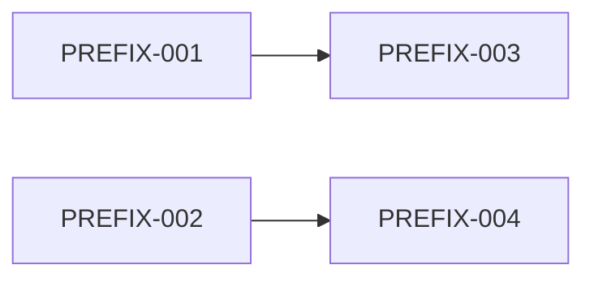
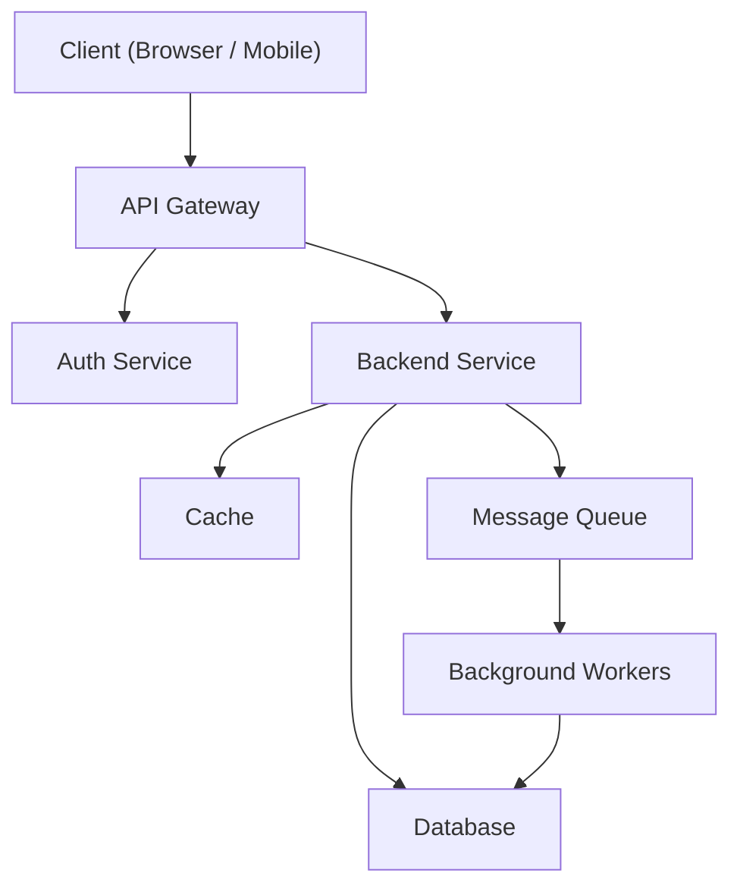

# Template Catalog — Phase 3 (SCAFFOLD)

> **Purpose**: Every template in this file is used by the `/setup-workflow` skill during
> Phase 3 to generate the project memory-repo scaffold. Templates are 100 %
> project-agnostic. All project-specific values come from `{{VARIABLE}}`
> placeholders that the scaffold engine substitutes at generation time.
>
> **Delimiter convention**: each template is wrapped in
> `<!-- TEMPLATE: <id> -->` ... `<!-- /TEMPLATE -->` HTML comments so the
> scaffold engine can extract them programmatically.

---

## Variable Reference (quick lookup)

| Variable | Source | Example |
|---|---|---|
| `{{PROJECT_NAME}}` | user input | Acme Platform |
| `{{PROJECT_SLUG}}` | derived | acme-platform |
| `{{PROJECT_DESCRIPTION}}` | user input | Multi-tenant SaaS billing platform |
| `{{DOMAIN}}` | user input | fintech / health / edtech ... |
| `{{PREFIX}}` | user input or derived | ACM |
| `{{REPO_TOPOLOGY}}` | detection | single / multi / mono |
| `{{REPO_TABLE_ROWS}}` | generated per topology | markdown table rows |
| `{{AGENT_ROSTER_ROWS}}` | agents.roster | markdown table rows |
| `{{MIGRATION_TOOL}}` | detection | alembic / knex / prisma ... |
| `{{BACKEND_LANGUAGE}}` | detection | Python / TypeScript / Go ... |
| `{{BACKEND_VERSION}}` | detection | 3.12 / 20 LTS ... |
| `{{BACKEND_FRAMEWORK}}` | detection | FastAPI / Express / Gin ... |
| `{{BACKEND_ORM}}` | detection | SQLAlchemy / Prisma / GORM ... |
| `{{BACKEND_TEST_RUNNER}}` | detection | pytest / jest / go test ... |
| `{{BACKEND_LINTER}}` | detection | ruff / eslint / golangci-lint ... |
| `{{BACKEND_FORMATTER}}` | detection | black / prettier / gofmt ... |
| `{{BACKEND_TYPECHECKER}}` | detection | mypy / tsc / — ... |
| `{{FRONTEND_LANGUAGE}}` | detection | TypeScript / JavaScript |
| `{{FRONTEND_VERSION}}` | detection | 5.4 / ES2024 |
| `{{FRONTEND_FRAMEWORK}}` | detection | React / Vue / Svelte ... |
| `{{FRONTEND_STATE}}` | detection | Redux / Pinia / Zustand ... |
| `{{FRONTEND_TEST_RUNNER}}` | detection | vitest / jest / playwright ... |
| `{{FRONTEND_LINTER}}` | detection | eslint / biome ... |
| `{{FRONTEND_FORMATTER}}` | detection | prettier / biome ... |
| `{{FRONTEND_BUNDLER}}` | detection | vite / webpack / turbopack ... |
| `{{DB_ENGINE}}` | detection | PostgreSQL / MySQL / MongoDB ... |
| `{{DB_VERSION}}` | detection | 16 / 8.0 / 7.0 ... |
| `{{DB_DRIVER}}` | detection | psycopg / mysql2 / pymongo ... |
| `{{AUTH_APPROACH}}` | detection or user input | JWT / OAuth2 / Session ... |
| `{{TOKEN_FORMAT}}` | detection or user input | Bearer JWT / Cookie ... |
| `{{API_STYLE}}` | detection or user input | REST / GraphQL / gRPC ... |
| `{{BASE_URL}}` | user input | /api/v1 |
| `{{VERSIONING_STRATEGY}}` | user input | URL prefix / Header ... |
| `{{DATE}}` | generated | YYYY-MM-DD |
| `{{SPRINT_GOAL}}` | user input | Foundation & Auth |
| `{{START}}` | user input | YYYY-MM-DD |
| `{{END}}` | user input | YYYY-MM-DD |
| `{{N}}` | sprint number | 1 |
| `{{POINTS}}` | capacity | 21 |
| `{{TERM}}` | glossary extraction | Tenant |
| `{{DEFINITION}}` | glossary extraction | An isolated customer account ... |
| `{{SECTION}}` | FRD reference | 3.2.1 |

---

<!-- ====================================================================== -->
<!-- TEMPLATE 1 — CLAUDE.md (Root Contract)                                 -->
<!-- ====================================================================== -->

<!-- TEMPLATE: claude-md -->
# {{PROJECT_NAME}} — CLAUDE.md

> **This file is the root contract for every agent and human working in this
> repository.** Read it completely before doing anything else.

---

## What This Project Is

**{{PROJECT_NAME}}** — {{PROJECT_DESCRIPTION}}

- **Domain**: {{DOMAIN}}
- **Repo topology**: {{REPO_TOPOLOGY}}

---

## Repo Topology

| Repo | Purpose | Primary Language | Owner Agent |
|---|---|---|---|
{{REPO_TABLE_ROWS}}

> _For **single-repo** projects the table has one row. For **multi-repo** or
> **mono-repo** projects, each package / service gets its own row._

---

## Team & Agent Roster

| Role | Agent ID | Scope | Repos |
|---|---|---|---|
{{AGENT_ROSTER_ROWS}}

---

## Story Lifecycle

```
draft ──► ready ──► in-progress ──► review ──► done
                        │                        │
                        ▼                        ▼
                    blocked                   rejected
                        │                        │
                        └──► ready ◄─────────────┘
```

A story may only move **forward** through the lifecycle unless it is
explicitly **blocked** or **rejected**, at which point it returns to `ready`.

---

## Source of Truth

| Artifact | Location | Format |
|---|---|---|
| Stories | `stories/` | Markdown + YAML frontmatter |
| Epics | `epics/` | Markdown + YAML frontmatter |
| ADRs | `docs/adr/` | Nygard ADR format |
| API Contracts | `contracts/api/` | OpenAPI 3.x YAML |
| Event Contracts | `contracts/events/` | Markdown / AsyncAPI |
| FRD | `docs/frd/` | Markdown (read-only) |
| Glossary | `docs/glossary.md` | Markdown table |
| Architecture | `docs/architecture.md` | Markdown + Mermaid |
| Tech Stack | `techstack/` | Markdown tables |
| Backlog Tracker | `tracker.md` | Markdown tables |
| Sprint Board | `sprint-board.md` | Markdown tables + Mermaid |
| Sprint Current | `sprints/sprint-{{N}}.md` | Markdown |
| Metrics | `metrics.md` | Markdown tables |

---

## Global Guardrails

Every agent and human MUST follow these rules without exception.

1. **Read first.** Before starting any task, read this file (`CLAUDE.md`),
   then your agent definition (`agents/<your-id>.md`), then the assigned
   story. Do not skip any of these.

2. **Stay in your declared scope.** Only modify files and repos listed in
   your agent definition. If work falls outside your scope, escalate to the
   Scrum Master.

3. **Commit trail.** Every commit message MUST end with `Refs: {{PREFIX}}-<id>`
   linking back to the story being worked. Commits without a story reference
   are forbidden.

4. **One story = one branch.** Each story is developed on a dedicated branch
   named `{{PREFIX}}-<id>`. Do not mix work from multiple stories in a single
   branch.

5. **Respect contracts.** API and event contracts in `contracts/` are the
   source of truth for request/response shapes. Run `/contract-update` and
   get architect approval before changing any contract. Code implements
   contracts, not the reverse.

6. **Update story frontmatter.** When a story changes state (e.g., `ready`
   to `in-progress`), update the `status` and `updated` fields in the
   story's YAML frontmatter immediately.

7. **Never modify the FRD.** The Functional Requirements Document in
   `docs/frd/` is read-only. If you find an error or gap, escalate to the
   Scrum Master who will coordinate with the Product Owner.

8. **Never edit stories after `ready`.** Once a story reaches `ready` status,
   its scope is frozen. If changes are needed, create a new story or
   escalate to the Scrum Master. Implementation Notes, Code Review, QA
   Verification, and Pipeline Progress sections are the only sections that
   may be updated after `ready`.

9. **Never write code in the memory repo.** If the project uses a multi-repo
   topology, the memory repo contains only documentation, stories, epics,
   contracts, and tracking files. Source code belongs in the appropriate
   service repo.

10. **No secrets, PII, or credentials.** Never commit API keys, passwords,
    tokens, personal data, or any sensitive material to any repository.
    Use environment variables and secret managers.

11. **Agents never commit, push, merge, or run migrations.** Agents prepare
    changes and request human review. Only humans (or CI pipelines with
    human approval) execute git operations and database migrations.

---

## Database Change Control

- **Migration tool**: {{MIGRATION_TOOL}}
- All schema changes MUST go through a migration file.
- Migration files live in the location dictated by {{MIGRATION_TOOL}} conventions.
- Migrations are reviewed by the architect agent before execution.
- Destructive migrations (dropping columns/tables) require an ADR.
- Data migrations are separate from schema migrations.
- Rollback scripts are mandatory for every migration.
- Agents prepare migration files but NEVER execute them.
- Only humans or approved CI pipelines run migrations against real databases.

---

## Agent Reading Priority

When an agent starts a task, it MUST read files in this order:

1. `CLAUDE.md` (this file)
2. `agents/<agent-id>.md` (own agent definition)
3. The assigned story in `stories/{{PREFIX}}-NNN.md`
4. The parent epic in `epics/EPIC-{{PREFIX}}-NNN.md`
5. Relevant contracts in `contracts/`
6. `docs/architecture.md`
7. `docs/glossary.md`
8. Relevant tech stack file in `techstack/`
9. Related stories referenced in the `dependencies` field
10. `docs/frd/` sections referenced in the story's `frd_refs`

---

## Definition of Ready (Reference)

A story is `ready` when ALL of the following are true:

- [ ] YAML frontmatter is complete (all required fields populated)
- [ ] `frd_refs` contains at least one FRD section reference
- [ ] Parent epic exists and is linked
- [ ] Acceptance Criteria are written in Gherkin format
- [ ] Test Plan specifies targets for unit, integration, and e2e
- [ ] Dependencies list is complete (or explicitly empty)
- [ ] Open Questions are all resolved (no unresolved items)
- [ ] Story points are between 1 and 5 (inclusive)
- [ ] No secrets, credentials, or PII appear in the story

---

## Definition of Done (Reference)

A story is `done` when ALL of the following are true:

**Implementation**
- [ ] All Acceptance Criteria pass
- [ ] Code compiles / builds without errors
- [ ] No new lint warnings introduced

**Contracts**
- [ ] API contracts match implementation
- [ ] Event contracts match implementation (if applicable)

**Tests**
- [ ] Unit test targets met per Test Plan
- [ ] Integration test targets met per Test Plan
- [ ] E2E test targets met per Test Plan
- [ ] No regressions in existing test suite

**Quality**
- [ ] Code reviewed by code-reviewer agent
- [ ] Review feedback addressed
- [ ] No TODO/FIXME items left unresolved

**Process**
- [ ] Story frontmatter updated to `done`
- [ ] Implementation Notes section filled
- [ ] Commit trail links to story ID (`Refs: {{PREFIX}}-<id>`)

**QA Verification**
- [ ] QA engineer has verified all AC
- [ ] QA Verification section filled in story

---

## Escalation Policy

| Situation | Escalate To | Method |
|---|---|---|
| Story scope unclear | Scrum Master | Update story Open Questions |
| Story blocked by dependency | Scrum Master | Add to Blockers section |
| Contract change needed | Architect | Run `/contract-update` |
| FRD error or gap found | Scrum Master → Product Owner | Add to Blockers section |
| Cross-repo conflict | Architect | Create ADR |
| Security concern | Architect + Scrum Master | Create ADR |
| Agent scope exceeded | Scrum Master | Update story Open Questions |
| Points estimate > 5 | Scrum Master | Split story |
| Test failures in CI | Dev agent who authored code | Blocker in story |

---

## Change Control

This file (`CLAUDE.md`) is under change control.

- Any modification requires an ADR documenting the reason.
- The Scrum Master must approve the ADR before the change is applied.
- Changes are versioned via git history.
- The ADR must reference which guardrail or section is being modified.
<!-- /TEMPLATE -->

---

<!-- ====================================================================== -->
<!-- TEMPLATE 2 — story.template.md                                         -->
<!-- ====================================================================== -->

<!-- TEMPLATE: story-template -->
---
id: {{PREFIX}}-NNN
title: ""
status: draft
epic: EPIC-{{PREFIX}}-NNN
repo: backend | frontend | rbac | multiple
assignee: ""
points: 0
sprint: 0
frd_refs: []
created: YYYY-MM-DD
updated: YYYY-MM-DD
---

# {{PREFIX}}-NNN: Story Title

## User Story

**As a** [role],
**I want** [feature],
**so that** [benefit].

## Context

- **FRD Reference**: See §X.Y of the Functional Requirements Document.
- **Why now**: Explain the sequencing rationale — what must exist before this
  story and what this story unblocks.
- **Related stories**: List any stories that overlap in scope or share data
  models (e.g., {{PREFIX}}-004, {{PREFIX}}-007).

## Technical Notes

- **Affected repos**: List every repo that this story touches.
- **Affected areas**: List modules, packages, or directories impacted.
- **External integrations**: List any third-party APIs or services involved.
- **Data model touches**: List any database tables or collections created,
  modified, or queried.

## Cross-Repo Impact

> _Include this section only for multi-repo or mono-repo topologies._

| Repo | Responsibility | Files / Areas |
|---|---|---|
| backend | ... | ... |
| frontend | ... | ... |
| rbac | ... | ... |

## Acceptance Criteria

> _All criteria MUST be in Gherkin format._

### Happy Path

```gherkin
Given [precondition]
When [action]
Then [expected result]
```

### Validation

```gherkin
Given [precondition with invalid input]
When [action]
Then [validation error result]
```

### Authorization

```gherkin
Given [user without required permission]
When [action]
Then [authorization error result]
```

### Edge Cases

```gherkin
Given [edge-case precondition]
When [action]
Then [edge-case result]
```

## Test Plan

| Layer | Target | Description |
|---|---|---|
| Unit | ≥ 90 % coverage of new code | Test individual functions and methods in isolation |
| Integration | All API endpoints touched | Test service interactions and database queries |
| E2E | Critical user journey | Test the full happy-path scenario end-to-end |
| Regression | Existing test suite passes | Ensure no regressions in unrelated functionality |
| Manual | Edge cases requiring human judgment | List specific manual verification steps |

## Dependencies

| Blocking Story | Reason |
|---|---|
| {{PREFIX}}-NNN | Describe why this story must complete first |

> _If there are no dependencies, write "None" here._

## Open Questions

| # | Question | Owner | Raised | Resolved |
|---|---|---|---|---|
| 1 | ... | @role | YYYY-MM-DD | — |

> _All questions MUST be resolved before the story moves to `ready`._

## Definition of Ready Checklist

- [ ] YAML frontmatter is complete (all required fields populated)
- [ ] `frd_refs` contains at least one FRD section reference
- [ ] Parent epic exists and is linked in `epic` field
- [ ] Acceptance Criteria are written in Gherkin format
- [ ] Test Plan specifies targets for unit, integration, and e2e
- [ ] Dependencies list is complete (or explicitly marked "None")
- [ ] All Open Questions are resolved
- [ ] Story points are between 1 and 5 (inclusive)
- [ ] No secrets, credentials, or PII appear in this story

## Definition of Done Checklist

### Implementation
- [ ] All Acceptance Criteria pass
- [ ] Code compiles / builds without errors
- [ ] No new lint warnings introduced

### Contracts
- [ ] API contracts in `contracts/api/` match implementation
- [ ] Event contracts in `contracts/events/` match implementation (if applicable)

### Tests
- [ ] Unit test targets met per Test Plan
- [ ] Integration test targets met per Test Plan
- [ ] E2E test targets met per Test Plan
- [ ] No regressions in existing test suite

### Quality
- [ ] Code reviewed by code-reviewer agent
- [ ] All review feedback addressed
- [ ] No unresolved TODO / FIXME items

### Process
- [ ] Story frontmatter `status` updated to `done`
- [ ] Story frontmatter `updated` date set to today
- [ ] Implementation Notes section filled
- [ ] All commits reference `Refs: {{PREFIX}}-NNN`

### QA Verification
- [ ] QA engineer has verified all Acceptance Criteria
- [ ] QA Verification section filled below

## Implementation Notes

> _Filled by the dev agent during implementation. Do not fill before
> `in-progress`._

- **Approach**: Describe the implementation approach taken.
- **Key decisions**: List any decisions made during implementation that were
  not covered by the story or architecture docs.
- **Deviations**: Note any deviations from the original plan and why.
- **Files changed**: List key files created or modified.

## Code Review

> _Filled by the code-reviewer agent. Do not fill before `review`._

- **Reviewer**: agent ID
- **Date**: YYYY-MM-DD
- **Verdict**: approved | changes-requested
- **Summary**: One-paragraph summary of the review.
- **Findings**:
  - [ ] Finding 1 — description and resolution
  - [ ] Finding 2 — description and resolution

## QA Verification

> _Filled by the qa-engineer agent. Do not fill before `review`._

- **QA Engineer**: agent ID
- **Date**: YYYY-MM-DD
- **Verdict**: passed | failed
- **Environment**: Describe the test environment.
- **Results**:
  | AC # | Description | Result | Notes |
  |---|---|---|---|
  | 1 | Happy path | pass / fail | ... |
  | 2 | Validation | pass / fail | ... |
  | 3 | Authorization | pass / fail | ... |
  | 4 | Edge cases | pass / fail | ... |

## Pipeline Progress

> _Managed by `/story-develop`. Do not edit manually._

| Checkpoint | Status | Timestamp |
|---|---|---|
| pickup | pending | — |
| implement | pending | — |
| lint | pending | — |
| review | pending | — |
| qa | pending | — |
| done-check | pending | — |
| epic-check | pending | — |

## Blockers

> _Logged by any agent. Each blocker must have an owner and a resolution
> plan._

| # | Description | Raised By | Date | Status | Resolution |
|---|---|---|---|---|---|
| 1 | ... | @agent-id | YYYY-MM-DD | open / resolved | ... |
<!-- /TEMPLATE -->

---

<!-- ====================================================================== -->
<!-- TEMPLATE 3 — epic.template.md                                          -->
<!-- ====================================================================== -->

<!-- TEMPLATE: epic-template -->
---
id: EPIC-{{PREFIX}}-NNN
title: ""
status: draft | in-progress | done
frd_section: ""
created: YYYY-MM-DD
updated: YYYY-MM-DD
---

# EPIC-{{PREFIX}}-NNN: Epic Title

## Goal

One paragraph describing what this epic achieves and why it matters. This
should tie directly to a section of the FRD and describe the business value
delivered when all stories under this epic are complete.

## FRD Reference

- **Section**: §X.Y — Section Title
- **Link**: `docs/frd/section-x-y.md` (or appropriate path)

## In Scope

- Capability or deliverable that IS included in this epic
- Another included capability
- Another included capability

## Out of Scope

- Capability or deliverable that is explicitly NOT included
- Another excluded capability
- Another excluded capability

## Success Criteria

- [ ] Measurable criterion 1 (e.g., "All CRUD endpoints for Resource X are
  operational and covered by integration tests")
- [ ] Measurable criterion 2
- [ ] Measurable criterion 3

## Stories

| ID | Title | Status | Points |
|---|---|---|---|
| {{PREFIX}}-NNN | Story title | draft | 0 |
| {{PREFIX}}-NNN | Story title | draft | 0 |
| {{PREFIX}}-NNN | Story title | draft | 0 |

**Total points**: 0

## Dependencies

| Epic | Relationship | Notes |
|---|---|---|
| EPIC-{{PREFIX}}-NNN | blocks / blocked-by | Description of dependency |

> _If there are no dependencies, write "None" here._

## Notes

- Additional context, architectural considerations, or open items that apply
  to the epic as a whole rather than to individual stories.
<!-- /TEMPLATE -->

---

<!-- ====================================================================== -->
<!-- TEMPLATE 4 — ADR template (Nygard format)                              -->
<!-- ====================================================================== -->

<!-- TEMPLATE: adr-template -->
# ADR-NNN: Title

## Status

Proposed | Accepted | Superseded by ADR-NNN

## Context

What is the issue that is motivating this decision or change? Describe the
forces at play — technical, political, social, and project-specific. The
language in this section is value-neutral; it is simply describing facts and
the tensions between them.

## Decision

What is the change that we are proposing and/or doing? State the decision
in full sentences, with active voice. "We will ..."

## Consequences

What becomes easier or more difficult to do because of this change? List
both positive and negative consequences.

**Positive consequences**:
- Benefit 1
- Benefit 2

**Negative consequences**:
- Trade-off 1
- Trade-off 2

**Neutral observations**:
- Observation 1
<!-- /TEMPLATE -->

---

<!-- ====================================================================== -->
<!-- TEMPLATE 5 — tracker.md (Backlog Tracker)                              -->
<!-- ====================================================================== -->

<!-- TEMPLATE: tracker -->
# Backlog Tracker

_Last updated: {{DATE}}_

## Epic Summary

| Epic | Title | Stories | Done | Status |
|---|---|---|---|---|
| EPIC-{{PREFIX}}-000 | Foundation | 0 | 0 | draft |

## Story Status

| ID | Title | Epic | Status | Sprint | Points |
|---|---|---|---|---|---|
| {{PREFIX}}-001 | ... | EPIC-{{PREFIX}}-000 | draft | — | 0 |

---

### Status Legend

| Status | Meaning |
|---|---|
| `draft` | Story is being written, not yet ready for development |
| `ready` | Story passes Definition of Ready, available for sprint planning |
| `in-progress` | Story is actively being worked on |
| `review` | Code review and QA verification in progress |
| `done` | Story passes Definition of Done |
| `blocked` | Story cannot proceed — see Blockers section in story |
| `rejected` | Story returned from review — rework needed |

---

### Maintenance Notes

- This file is the single view of all stories and epics in the backlog.
- Update this file whenever a story or epic changes status.
- The `/story-develop` pipeline updates this file automatically at the
  `done-check` and `epic-check` checkpoints.
- Manual edits are allowed but should be followed by a consistency check.
<!-- /TEMPLATE -->

---

<!-- ====================================================================== -->
<!-- TEMPLATE 6 — sprint-board.md                                           -->
<!-- ====================================================================== -->

<!-- TEMPLATE: sprint-board -->
# Sprint Board

## Sprint 1 — {{SPRINT_GOAL}}

**Status**: planned | in-progress | done
**Points**: 0 committed / 0 done
**Dates**: {{START}} to {{END}}

### Sprint 1 — Stories

| ID | Title | Status | Assignee | Points |
|---|---|---|---|---|
| {{PREFIX}}-001 | ... | ready | — | 0 |

### Sprint 1 — Dependency Graph



> _Update the dependency graph whenever stories are added, removed, or
> re-sequenced within the sprint._

---

## Backlog (Unscheduled)

| ID | Title | Epic | Points | Dependencies |
|---|---|---|---|---|
| {{PREFIX}}-015 | ... | EPIC-{{PREFIX}}-003 | 0 | {{PREFIX}}-012 |

---

### Board Maintenance Notes

- Move stories between "Sprint N — Stories" and "Backlog (Unscheduled)" during
  sprint planning.
- Update the points summary in each sprint header as stories change status.
- When a sprint completes, change its **Status** to `done` and add the next
  sprint section below using the sprint-current template.
- The Scrum Master is responsible for keeping this board in sync with the
  tracker and individual story files.
<!-- /TEMPLATE -->

---

<!-- ====================================================================== -->
<!-- TEMPLATE 7 — glossary.md                                               -->
<!-- ====================================================================== -->

<!-- TEMPLATE: glossary -->
# {{PROJECT_NAME}} — Domain Glossary

_Terms extracted from the FRD. Single source for domain vocabulary across all
repos, stories, contracts, and agent communications._

_Last updated: {{DATE}}_

| Term | Definition | FRD Reference |
|---|---|---|
| {{TERM}} | {{DEFINITION}} | §{{SECTION}} |

---

### Glossary Rules

1. **Canonical source.** This glossary is the canonical definition for every
   domain term used in the project. If a term appears in code, stories, or
   contracts, its meaning MUST match this glossary.
2. **FRD-derived.** All terms are extracted from or traceable to the FRD.
   Do not add terms that are not mentioned in or implied by the FRD.
3. **Alphabetical order.** Keep entries sorted alphabetically by Term.
4. **No duplicates.** Each term appears exactly once. Use the FRD Reference
   column to link to all relevant sections.
5. **Change process.** Adding or modifying a glossary term requires Scrum
   Master approval. If the change reflects a gap in the FRD, escalate to the
   Product Owner.
<!-- /TEMPLATE -->

---

<!-- ====================================================================== -->
<!-- TEMPLATE 8 — architecture.md                                           -->
<!-- ====================================================================== -->

<!-- TEMPLATE: architecture -->
# {{PROJECT_NAME}} — Architecture Overview

_Last updated: {{DATE}}_

## System Overview

{{PROJECT_NAME}} is {{PROJECT_DESCRIPTION}}. This document describes the
high-level architecture, technology choices, and design patterns that guide
all implementation work. It is a living document maintained by the architect
agent and updated via ADRs.

---

## Tech Stack

| Layer | Technology | Version | Notes |
|---|---|---|---|
| Backend Language | {{BACKEND_LANGUAGE}} | {{BACKEND_VERSION}} | — |
| Backend Framework | {{BACKEND_FRAMEWORK}} | — | — |
| Frontend Language | {{FRONTEND_LANGUAGE}} | {{FRONTEND_VERSION}} | — |
| Frontend Framework | {{FRONTEND_FRAMEWORK}} | — | — |
| Primary Database | {{DB_ENGINE}} | {{DB_VERSION}} | — |
| ORM / Query Builder | {{BACKEND_ORM}} | — | — |
| Migration Tool | {{MIGRATION_TOOL}} | — | — |
| Authentication | {{AUTH_APPROACH}} | — | — |
| API Style | {{API_STYLE}} | — | — |

> _See `techstack/` for detailed stack files per layer._

---

## High-Level Architecture



> _Replace this placeholder diagram with the actual architecture once the
> system design is finalized. Keep it as a Mermaid diagram for easy
> maintenance._

---

## API Design

- **Style**: {{API_STYLE}}
- **Base URL**: `{{BASE_URL}}`
- **Versioning strategy**: {{VERSIONING_STRATEGY}}
- **Contract location**: `contracts/api/`
- **Authentication**: All endpoints require authentication unless explicitly
  marked as public in the contract.
- **Error format**: Standardized error envelope:
  ```json
  {
    "error": {
      "code": "ERROR_CODE",
      "message": "Human-readable message",
      "details": {}
    }
  }
  ```
- **Pagination**: Cursor-based pagination for list endpoints.
- **Rate limiting**: Applied at the API gateway level.

---

## Database Design

- **Primary database**: {{DB_ENGINE}} {{DB_VERSION}}
- **Migration strategy**: All schema changes go through {{MIGRATION_TOOL}}.
  See Database Change Control in `CLAUDE.md`.
- **Naming conventions**:
  - Tables: `snake_case`, plural (e.g., `users`, `order_items`)
  - Columns: `snake_case` (e.g., `created_at`, `user_id`)
  - Indexes: `idx_<table>_<column>` (e.g., `idx_users_email`)
  - Foreign keys: `fk_<table>_<referenced_table>` (e.g., `fk_orders_users`)
  - Constraints: `chk_<table>_<description>` (e.g., `chk_users_email_format`)
- **Soft deletes**: Preferred over hard deletes. Use a `deleted_at` timestamp
  column.
- **Timestamps**: All tables include `created_at` and `updated_at` columns
  with UTC timezone.
- **UUIDs**: Use UUIDs (v4) for primary keys in public-facing entities.

---

## Authentication

- **Approach**: {{AUTH_APPROACH}}
- **Token format**: {{TOKEN_FORMAT}}
- **Token lifetime**: Access tokens expire after a short duration; refresh
  tokens are long-lived.
- **Storage**: Tokens are stored securely on the client side (httpOnly cookies
  for web, secure storage for mobile).
- **Authorization model**: Role-Based Access Control (RBAC) with permissions
  defined per endpoint in API contracts.

---

## Cost Model

> _Include this section if the system has an AI layer or metered external
> service usage._

| Operation | Provider | Estimated Cost | Notes |
|---|---|---|---|
| LLM inference | — | — | Per-token pricing |
| Image generation | — | — | Per-image pricing |
| Search indexing | — | — | Per-document pricing |
| Email sending | — | — | Per-message pricing |

> _Update this table as integrations are finalized. Costs inform
> architectural decisions about caching, batching, and rate limiting._

---

## Deployment

> _Fill in once the deployment strategy is finalized._

- **Environment tiers**: development / staging / production
- **Infrastructure**: (e.g., AWS, GCP, Azure, self-hosted)
- **Container orchestration**: (e.g., Kubernetes, ECS, Docker Compose)
- **CI/CD pipeline**: (e.g., GitHub Actions, GitLab CI, Jenkins)
- **Deployment strategy**: (e.g., blue-green, canary, rolling)
- **Monitoring**: (e.g., Datadog, Grafana, CloudWatch)
- **Logging**: (e.g., ELK stack, CloudWatch Logs, Loki)
- **Alerting**: (e.g., PagerDuty, OpsGenie, Slack webhooks)
<!-- /TEMPLATE -->

---

<!-- ====================================================================== -->
<!-- TEMPLATE 9 — metrics.md                                                -->
<!-- ====================================================================== -->

<!-- TEMPLATE: metrics -->
# Sprint Velocity & Metrics

_Last updated: {{DATE}}_

## Velocity

| Sprint | Committed | Completed | Velocity |
|---|---|---|---|
| 1 | — | — | — |

> _Velocity = story points completed in a sprint. Track this over time to
> improve estimation accuracy and capacity planning._

## Cycle Time (Ready to Done)

| Sprint | Avg Days | Median Days |
|---|---|---|
| 1 | — | — |

> _Cycle time measures how long a story takes from `ready` to `done`.
> Shorter cycle times indicate better flow. Investigate outliers._

## Defect Escape Rate

| Sprint | Stories Done | Post-Sprint Bugs | Escape Rate |
|---|---|---|---|
| 1 | — | — | — |

> _Escape rate = post-sprint bugs / stories done. A rising escape rate
> signals quality issues in the Definition of Done process._

## Throughput

| Sprint | Stories Started | Stories Completed | Completion Rate |
|---|---|---|---|
| 1 | — | — | — |

> _Throughput tracks stories completed per sprint regardless of points.
> Combined with velocity, it helps identify whether stories are consistently
> sized._

## Sprint Burndown Data

| Sprint | Day | Remaining Points |
|---|---|---|
| 1 | 1 | — |
| 1 | 2 | — |
| 1 | 3 | — |

> _Use this data to generate burndown charts. Update daily during active
> sprints._

---

### Metrics Maintenance Notes

- Update this file at the end of each sprint during the sprint review.
- The Scrum Master is responsible for maintaining accuracy.
- Historical data is never deleted — only appended.
- Use these metrics to drive retrospective discussions.
<!-- /TEMPLATE -->

---

<!-- ====================================================================== -->
<!-- TEMPLATE 10 — sprint-current.md                                        -->
<!-- ====================================================================== -->

<!-- TEMPLATE: sprint-current -->
# Sprint {{N}} — {{GOAL}}

**Dates**: {{START}} to {{END}}
**Capacity**: {{POINTS}} points

## Sprint Goal

{{GOAL}} — Describe what the team aims to deliver by the end of this sprint
and why it matters for the overall project trajectory.

## Committed Stories

| ID | Title | Status | Assignee |
|---|---|---|---|
| {{PREFIX}}-NNN | ... | ready | — |
| {{PREFIX}}-NNN | ... | ready | — |
| {{PREFIX}}-NNN | ... | ready | — |

**Total committed**: 0 points
**Completed**: 0 points

## Daily Log

### Day 1 — {{DATE}}
- Sprint kickoff
- Stories assigned to agents
- Updates...

### Day 2 — {{DATE}}
- Updates...

### Day 3 — {{DATE}}
- Updates...

> _Add a new day section each working day. Record key events: story
> completions, blockers raised, blockers resolved, scope changes._

## Sprint Review Notes

> _Filled at the end of the sprint._

- **Stories completed**: X of Y
- **Points completed**: X of Y
- **Velocity**: X
- **Carry-over stories**: List any stories not completed and why.
- **Demo items**: List what was demonstrated to stakeholders.
- **Stakeholder feedback**: Summarize feedback received.

## Retrospective

> _Filled at the end of the sprint during the retrospective ceremony._

### What went well
-

### What didn't go well
-

### What was confusing or unclear
-

### Action items
| # | Action | Owner | Due Date | Status |
|---|---|---|---|---|
| 1 | ... | @role | YYYY-MM-DD | open |
<!-- /TEMPLATE -->

---

<!-- ====================================================================== -->
<!-- TEMPLATE 11 — contracts/api/README.md                                  -->
<!-- ====================================================================== -->

<!-- TEMPLATE: contracts-api-readme -->
# API Contracts

This directory contains OpenAPI / Swagger specifications for all API
endpoints in {{PROJECT_NAME}}.

## Rules

1. **Contracts are the source of truth** for request/response shapes. Code
   implements contracts, not the reverse.
2. **Any change to a contract** requires running `/contract-update` and
   getting explicit approval from the architect agent.
3. **Breaking changes** (removing fields, changing types, removing endpoints)
   require an ADR documenting the rationale and migration plan.
4. **Additive changes** (new optional fields, new endpoints) still require
   architect approval but do not need an ADR.
5. **Versioning**: API contracts follow the project's versioning strategy
   ({{VERSIONING_STRATEGY}}). Each breaking change bumps the API version.
6. **Naming convention**: Contract files are named
   `<resource>.<version>.yaml` (e.g., `users.v1.yaml`, `orders.v1.yaml`).

## Endpoints

_Add OpenAPI spec files here as endpoints are defined during story
implementation._

| Resource | File | Version | Status |
|---|---|---|---|
| — | — | — | — |

## Contract Review Process

1. Dev agent proposes a contract change as part of a story.
2. Dev agent runs `/contract-update` which notifies the architect.
3. Architect reviews the change against the FRD and existing contracts.
4. If approved, the contract is updated and the story proceeds.
5. If rejected, the architect provides feedback and the dev agent revises.

## File Format

All contracts use **OpenAPI 3.x** in YAML format. Example structure:

```yaml
openapi: 3.0.3
info:
  title: Resource Name API
  version: v1
paths:
  /resource:
    get:
      summary: List resources
      ...
    post:
      summary: Create resource
      ...
  /resource/{id}:
    get:
      summary: Get resource by ID
      ...
    put:
      summary: Update resource
      ...
    delete:
      summary: Delete resource
      ...
```
<!-- /TEMPLATE -->

---

<!-- ====================================================================== -->
<!-- TEMPLATE 12 — contracts/events/README.md                               -->
<!-- ====================================================================== -->

<!-- TEMPLATE: contracts-events-readme -->
# Event Contracts

This directory contains specifications for all asynchronous events,
webhooks, and message queue payloads in {{PROJECT_NAME}}.

## Rules

1. **Event contracts are the source of truth** for message shapes. Publishers
   and consumers implement contracts, not the reverse.
2. **Any change to an event contract** requires running `/contract-update`
   and getting explicit approval from the architect agent.
3. **Breaking changes** (removing fields, changing types, removing events)
   require an ADR documenting the rationale and migration plan for all
   affected consumers.
4. **Additive changes** (new optional fields, new event types) still require
   architect approval but do not need an ADR.
5. **Naming convention**: Event contract files are named
   `<domain>.<event-type>.yaml` (e.g., `orders.created.yaml`,
   `users.updated.yaml`).
6. **Backwards compatibility**: Consumers MUST be able to handle unknown
   fields gracefully (forward compatibility).

## Events

_Add event specification files here as events are defined during story
implementation._

| Domain | Event | File | Status |
|---|---|---|---|
| — | — | — | — |

## Event Review Process

1. Dev agent proposes an event contract as part of a story.
2. Dev agent runs `/contract-update` which notifies the architect.
3. Architect reviews the event against the FRD, existing contracts, and
   identifies all affected consumers.
4. If approved, the contract is created/updated and the story proceeds.
5. If rejected, the architect provides feedback and the dev agent revises.

## Event Envelope Format

All events follow a standard envelope:

```yaml
event:
  id: uuid-v4
  type: domain.event-type
  version: "1"
  timestamp: ISO-8601
  source: service-name
  correlation_id: uuid-v4
  payload:
    # Event-specific fields
```

## File Format

Event contracts use YAML. Example structure:

```yaml
name: orders.created
version: "1"
description: Emitted when a new order is successfully created.
source: backend
consumers:
  - notification-service
  - analytics-service
payload:
  type: object
  required:
    - order_id
    - user_id
    - total
    - created_at
  properties:
    order_id:
      type: string
      format: uuid
    user_id:
      type: string
      format: uuid
    total:
      type: number
      format: decimal
    created_at:
      type: string
      format: date-time
```
<!-- /TEMPLATE -->

---

<!-- ====================================================================== -->
<!-- TEMPLATE 13 — techstack/backend/stack.md                               -->
<!-- ====================================================================== -->

<!-- TEMPLATE: techstack-backend -->
# Backend Tech Stack

_Last updated: {{DATE}}_

| Component | Choice | Version | Rationale |
|---|---|---|---|
| Language | {{BACKEND_LANGUAGE}} | {{BACKEND_VERSION}} | Primary backend language selected during project setup |
| Framework | {{BACKEND_FRAMEWORK}} | — | Web framework for API development |
| ORM | {{BACKEND_ORM}} | — | Database abstraction and query building |
| Test Runner | {{BACKEND_TEST_RUNNER}} | — | Unit and integration test execution |
| Linter | {{BACKEND_LINTER}} | — | Static analysis and code quality enforcement |
| Formatter | {{BACKEND_FORMATTER}} | — | Consistent code formatting |
| Type Checker | {{BACKEND_TYPECHECKER}} | — | Static type verification |
| Migration Tool | {{MIGRATION_TOOL}} | — | Database schema versioning and migration execution |

## Configuration Files

| Tool | Config File | Location |
|---|---|---|
| {{BACKEND_LINTER}} | — | repo root or config directory |
| {{BACKEND_FORMATTER}} | — | repo root or config directory |
| {{BACKEND_TYPECHECKER}} | — | repo root or config directory |
| {{BACKEND_TEST_RUNNER}} | — | repo root or config directory |

> _Fill in config file names and locations as the project is initialized._

## Conventions

- **Package manager**: (e.g., pip, npm, go mod)
- **Dependency file**: (e.g., requirements.txt, package.json, go.mod)
- **Lock file**: (e.g., requirements.lock, package-lock.json, go.sum)
- **Source directory**: (e.g., src/, app/, internal/)
- **Test directory**: (e.g., tests/, __tests__/, *_test.go)
- **Entry point**: (e.g., main.py, index.ts, main.go)

## Quality Gates

All backend code MUST pass these checks before merging:

1. **Lint**: `{{BACKEND_LINTER}}` runs with zero errors
2. **Format**: `{{BACKEND_FORMATTER}}` produces no diff
3. **Type check**: `{{BACKEND_TYPECHECKER}}` passes with zero errors
4. **Tests**: `{{BACKEND_TEST_RUNNER}}` passes all tests
5. **Coverage**: Minimum coverage threshold met (configured in test runner)

## Notes

- Record any backend-specific architectural decisions or conventions here.
- Link to relevant ADRs for technology choices that required deliberation.
<!-- /TEMPLATE -->

---

<!-- ====================================================================== -->
<!-- TEMPLATE 14 — techstack/frontend/stack.md                              -->
<!-- ====================================================================== -->

<!-- TEMPLATE: techstack-frontend -->
# Frontend Tech Stack

_Last updated: {{DATE}}_

| Component | Choice | Version | Rationale |
|---|---|---|---|
| Language | {{FRONTEND_LANGUAGE}} | {{FRONTEND_VERSION}} | Primary frontend language |
| Framework | {{FRONTEND_FRAMEWORK}} | — | UI component framework |
| State Management | {{FRONTEND_STATE}} | — | Application state management |
| Bundler | {{FRONTEND_BUNDLER}} | — | Build and bundle tooling |
| Test Runner | {{FRONTEND_TEST_RUNNER}} | — | Unit, component, and integration test execution |
| Linter | {{FRONTEND_LINTER}} | — | Static analysis and code quality enforcement |
| Formatter | {{FRONTEND_FORMATTER}} | — | Consistent code formatting |
| CSS Approach | — | — | (e.g., Tailwind, CSS Modules, styled-components) |
| Component Library | — | — | (e.g., shadcn/ui, MUI, Ant Design, custom) |

## Configuration Files

| Tool | Config File | Location |
|---|---|---|
| {{FRONTEND_BUNDLER}} | — | repo root |
| {{FRONTEND_LINTER}} | — | repo root |
| {{FRONTEND_FORMATTER}} | — | repo root |
| {{FRONTEND_TEST_RUNNER}} | — | repo root |
| TypeScript | tsconfig.json | repo root |

> _Fill in config file names and locations as the project is initialized._

## Conventions

- **Package manager**: (e.g., npm, pnpm, yarn, bun)
- **Dependency file**: package.json
- **Lock file**: (e.g., package-lock.json, pnpm-lock.yaml, yarn.lock)
- **Source directory**: (e.g., src/, app/)
- **Components directory**: (e.g., src/components/)
- **Pages / Routes directory**: (e.g., src/pages/, src/routes/, app/)
- **Test directory**: (e.g., src/__tests__/, tests/, *.test.tsx alongside)
- **Public / Static assets**: (e.g., public/, static/)
- **Entry point**: (e.g., src/main.tsx, src/index.tsx, app/layout.tsx)

## Quality Gates

All frontend code MUST pass these checks before merging:

1. **Lint**: `{{FRONTEND_LINTER}}` runs with zero errors
2. **Format**: `{{FRONTEND_FORMATTER}}` produces no diff
3. **Type check**: TypeScript compiler (`tsc --noEmit`) passes with zero errors
4. **Tests**: `{{FRONTEND_TEST_RUNNER}}` passes all tests
5. **Build**: Production build completes without errors
6. **Coverage**: Minimum coverage threshold met (configured in test runner)

## Notes

- Record any frontend-specific architectural decisions or conventions here.
- Link to relevant ADRs for technology choices that required deliberation.
<!-- /TEMPLATE -->

---

<!-- ====================================================================== -->
<!-- TEMPLATE 15 — techstack/database/stack.md                              -->
<!-- ====================================================================== -->

<!-- TEMPLATE: techstack-database -->
# Database Tech Stack

_Last updated: {{DATE}}_

| Component | Choice | Version | Rationale |
|---|---|---|---|
| Engine | {{DB_ENGINE}} | {{DB_VERSION}} | Primary data store |
| Driver | {{DB_DRIVER}} | — | Application-level database driver |
| ORM | {{BACKEND_ORM}} | — | Object-relational mapping (shared with backend) |
| Migration Tool | {{MIGRATION_TOOL}} | — | Schema versioning and migration execution |
| Seed Tool | — | — | Test data seeding |
| Backup Tool | — | — | Backup and restore |
| GUI Client | — | — | (e.g., pgAdmin, DBeaver, TablePlus) |

## Schema Conventions

| Convention | Rule | Example |
|---|---|---|
| Table names | snake_case, plural | `users`, `order_items` |
| Column names | snake_case | `created_at`, `user_id` |
| Primary keys | `id`, UUID v4 for public entities | `id UUID DEFAULT gen_random_uuid()` |
| Foreign keys | `<referenced_table_singular>_id` | `user_id`, `order_id` |
| Index names | `idx_<table>_<columns>` | `idx_users_email` |
| FK constraint names | `fk_<table>_<referenced_table>` | `fk_orders_users` |
| Check constraint names | `chk_<table>_<description>` | `chk_users_email_format` |
| Unique constraint names | `uq_<table>_<columns>` | `uq_users_email` |
| Timestamps | UTC, `created_at` + `updated_at` on all tables | `TIMESTAMP WITH TIME ZONE` |
| Soft deletes | `deleted_at` column (nullable timestamp) | `deleted_at TIMESTAMP WITH TIME ZONE` |
| Booleans | `is_` prefix | `is_active`, `is_verified` |
| Enums | Database-level enum type or check constraint | `status_enum` |

## Migration Conventions

- **Directory**: As dictated by {{MIGRATION_TOOL}} defaults
- **File naming**: Sequential or timestamped as per {{MIGRATION_TOOL}} convention
- **One migration per change**: Do not bundle unrelated schema changes
- **Reversible**: Every migration MUST have a rollback / down script
- **Data migrations**: Separate files from schema migrations, clearly labeled
- **Destructive changes**: Require an ADR before execution (dropping tables,
  columns, or changing types)
- **Execution**: Agents prepare migration files but NEVER execute them. Only
  humans or approved CI pipelines run migrations.

## Environments

| Environment | Host | Port | Database Name | Notes |
|---|---|---|---|---|
| Development | localhost | — | {{PROJECT_SLUG}}_dev | Local development |
| Test | localhost | — | {{PROJECT_SLUG}}_test | Automated test suite |
| Staging | — | — | {{PROJECT_SLUG}}_staging | Pre-production |
| Production | — | — | {{PROJECT_SLUG}}_prod | Live production |

> _Never store connection strings or credentials in this file. Use
> environment variables._

## Backup Strategy

- **Frequency**: (e.g., daily full, hourly incremental)
- **Retention**: (e.g., 30 days)
- **Storage**: (e.g., S3, GCS, local)
- **Recovery testing**: (e.g., monthly restore test)

> _Fill in once the infrastructure and deployment strategy are finalized._

## Notes

- Record any database-specific architectural decisions or conventions here.
- Link to relevant ADRs for technology choices that required deliberation.
<!-- /TEMPLATE -->
